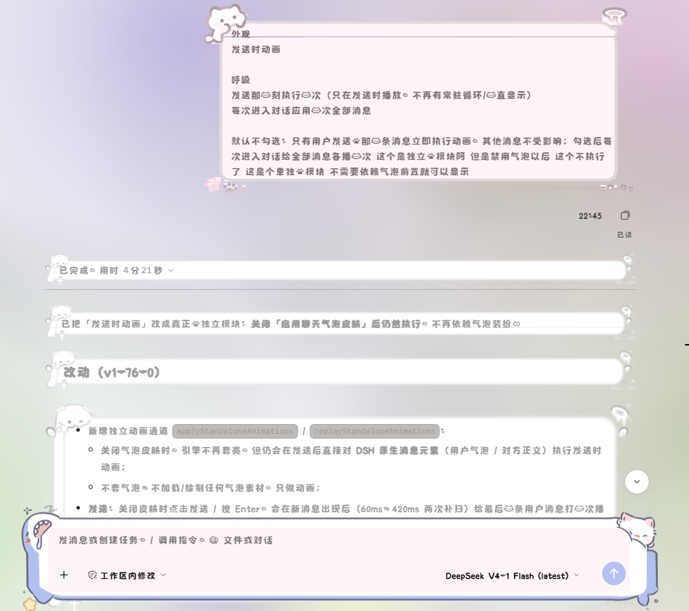
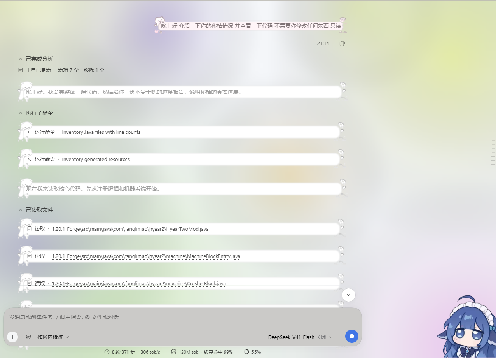
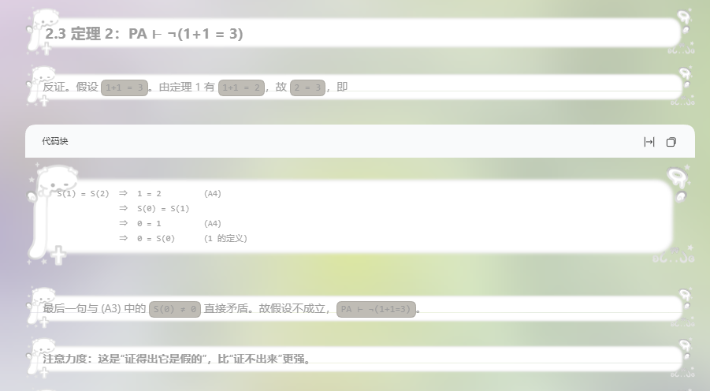

# dsh-deepseek-chatframe

给 DeepSeek Harness（DSH）用的聊天气泡皮肤插件：解析 `config.json` + `bubbleframe/*.png` 气泡包，在 DSH 设置页新增「DeepSeek聊天框」，把消息气泡替换成可逐帧动画的气泡框，进行一系列的美化ovo

[](package.json)
[](LICENSE)
[](#致谢与许可)

### 另外 本插件本身不带任何装扮 需要自行获取喵~

- 运行时依赖：**零**（Host 半纯 Node，无需构建）

## 预览

[](image/1.png)

[](image/2.png)

[](image/3.png)

## 目录

- [这是什么](#这是什么)
- [功能](#功能)
- [安装](#安装)
- [使用](#使用)
- [兼容性与已知限制](#兼容性与已知限制)
- [开发](#开发)
- [项目结构](#项目结构)
- [常见问题](#常见问题)
- [致谢与许可](#致谢与许可)

## 这是什么

DSH 默认的消息气泡是纯色圆角。本插件把它替换成**气泡包里的九宫格/中缝拉伸图案**，并支持多帧动画、输入框气泡、发送时动画、已读/未读状态与待下达指令镜像。

核心思路：

- 不写死像素：内洞、边框、文字内缩、缩放全部由**当前气泡图案实测** + 元素字号推导，换任何素材都自适应；
- Host 半侧只负责状态、素材扫描与帧下发，浏览器半侧负责绘制与动画；

## 功能

### 气泡装扮

- 左右两侧角色可分别选择气泡（我的消息 / DeepSeek 消息）；
- 支持普通目录、文件夹、`.zip` 等气泡包导入；
- Canvas `auto` 合成：在图案最空的一列/行做九宫格拉伸，保留原图图案；
- 多帧气泡自动播放帧动画，可调动画速度与整体缩放；
- 填充色自动取帧图白底平均色，也可手动覆盖；
- 裁切点 / 锚点 / 帧管理可视化编辑。

### 输入框气泡

- 内置「iMessage输入框」预设；
- 也可选择任意导入气泡作为输入框背景，不覆盖文字、光标与按钮。

### 发送时动画（独立模块）

- 内置 `iMessage 经典发送` / `iOS 26 飞入发送` 等预设；
- 只给发送时出现的那一条消息播放一次，播完立即移除标记；
- 插话 / 插入消息同样播放；
- 关闭「启用聊天气泡皮肤」后仍然生效，不依赖气泡装扮。

### 已读 / 未读

- 消息下方显示已读 / 未读，文字可自定义；
- 对方消息只在**正文**显示，思考 / 工具过程行不显示；
- 待下达指令（排队消息）按「未读」显示，并提供插话发送 / 编辑 / 删除；
- 左侧会话栏显示 `状态 · 会话标题`；
- 状态只存内存，不做持久化；空状态默认「已读」。

### 待下达指令（插话）

- 隐藏 DSH 原生队列 dock，把排队消息画成「DSH 原生已发送消息 + 插件气泡装扮」；
- 插话发送 / 编辑 / 删除复用 DSH 原生按钮；
- 编辑就在原气泡文字位置出现输入框：Enter 保存、Shift+Enter 换行、Esc 取消；
- 多条待下达指令显示一个汇总气泡 + 折叠式抽屉；
- 插话完成（durable steering）后仍与普通消息一样保留气泡。

### 性能

- Host：`state.json` 按 mtime 缓存、气泡清单按目录 mtime + 3s TTL 缓存、帧 PNG / 首帧缩略图按文件 mtime 缓存；
- 浏览器：单全局 `MutationObserver`、`bubbleEls` 集合驱动帧定时器、保存按钮增量脏检查、布局属性按需写入；
- 超极致模式只给当前屏幕上下文套气泡；
- 支持预加载气泡帧、折叠/空闲状态保留气泡。

## 安装

### 前置

- DSH `0.2.0-rc.2`（本插件按该版本的 slot 契约编写）
- **无需构建**：`client.js` 就是发布产物，手写、可读，便于静态审计

### 方式一：插件面板

1. 下载 / 克隆本目录到本机任意位置（安装后不要移动或删除）；
2. 打开 DSH Desktop → 设置 → 插件 → 添加插件；
3. 输入本插件的包名 `dsh-deepseek-chatframe` 或通过git安装 `github:sf326/dsh-deepseek-chatframe`

### 方式二：命令行

```powershell
dsh plugin --profile web add dsh-deepseek-chatframe
dsh --profile web --dump-config
```

确认配置里出现 `dsh-deepseek-chatframe`。

### 验证已生效

重开 DSH 后：

1. 设置 → **DeepSeek聊天框** → 顶部应显示最新版本；
2. 选择「我发的消息 / DeepSeek 消息」各一个气泡并保存，消息应立刻换肤；
3. 没有气泡素材时，先到设置页导入气泡包。

### 升级与卸载

- 升级：重新指向新目录 / 重装，然后完全退出并重开 DSH Desktop；
- 卸载：插件面板卸载；手工安装的用 `dsh plugin --profile <profile> remove dsh-deepseek-chatframe`。

> 不要直接删除 profile 里的 junction，可能顺着链接删掉插件本体。

## 使用

### 设置页结构

```
启用聊天气泡皮肤
  ├─ 性能模式
  ├─ 替换原来的输入框为气泡
  ├─ 无论状态是否空闲 始终应用气泡
  ├─ 预加载气泡
  ├─ 超极致模式
  ├─ 禁用所有气泡动画
  ├─ 气泡选择
  ├─ 动画预览
  ├─ 外观 → 气泡装扮
  ├─ 外观细节
  └─ 素材

独立功能
  ├─ 外观 → 气泡动画
  └─ 显示聊天风格指令（已读 / 未读）
```

### 素材目录

默认：

```
~/.dsh/deepseek-chatframe/bubbles
```

把气泡包目录或 `.zip` 放进去，或在设置页拖拽导入。

## 开发

包本身零依赖：

```powershell
node --check lib/index.js
node --check lib/client.js
```

- 浏览器半侧是手写的 `window.__ModuleLoader__.load({ ... })` bundle，无构建步骤；
- Host 半侧是 Node ESM，路由前缀 `/dsh-deepseek-chatframe`；
- 修改 Host 后必须完全退出 DSH（托盘右键退出）再启动；
- 离线断言套件在开发仓库的其他目录维护，本发布包不含 `test/`。

## 项目结构

```
dsh-deepseek-chatframe/
├─ lib/
│  ├─ index.js          Host 半侧：状态、素材扫描、帧路由
│  └─ client.js         浏览器半侧：设置面板、气泡绘制、动画
├─ cordis.patch.yml     把本包 insert 进 profile 组合层
├─ package.json         声明 dsh.bundle.patch 与 dsh.client
├─ LICENSE              BSD-3-Clause
└─ README.md
```
## 常见问题

**装完没反应？**
先完全退出并重开 DSH Desktop（不是关窗口）。再检查插件详情页有没有报错行。宿主直接 `JSON.parse` 读 `package.json`，清单损坏会导致整包被丢弃。

**面板显示旧版本 / 改代码不生效？**
DSH 的客户端 bundle 地址带启动时缓存的 `rev`，改客户端后需要**完全退出 DSH 再启动**；只刷新页面可能仍加载旧文件。

**消息没有换肤？**
确认已勾选「启用聊天气泡皮肤」、两个气泡都已选择并保存；没有素材时先在「素材」里导入气泡包。

**待下达指令没有气泡 / 没有动画？**
确认 `userBubble` 已选择；插话消息与普通消息共用同一套气泡与发送动画。

**已读/未读不显示？**
确认勾选「显示聊天风格指令」；对方消息只在正文显示，思考/工具过程行不显示。

**气泡包导入失败？**
确认包内有 `config.json` 与 `bubbleframe/` 目录；本插件不内置素材。

**插件报 `package.json: ENOENT`？**
插件元信息读取时 `package.json` 不存在。确认插件目录里有 `package.json`，并且 profile 里的本地依赖 tgz / link 指向的路径有效；修复后完全重启 DSH。

### 如果有其他异常 欢迎提Issues反馈~

## 致谢与许可

- 气泡包格式与九宫格思路来自聊天气泡包生态；
- [deepseek-ai/deepseek-harness](https://github.com/deepseek-ai/deepseek-harness) 探索未至之境；

许可：[BSD-3-Clause](LICENSE)。
